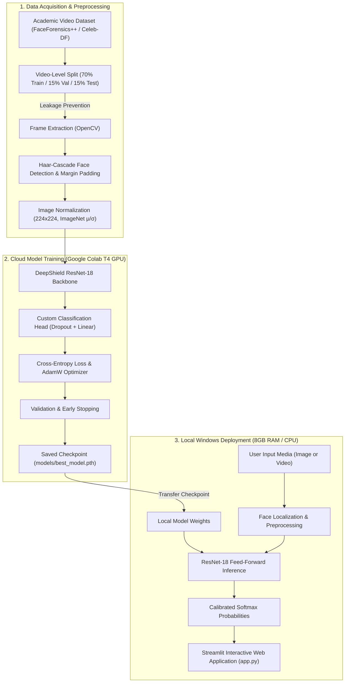
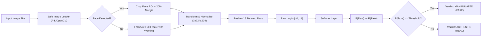
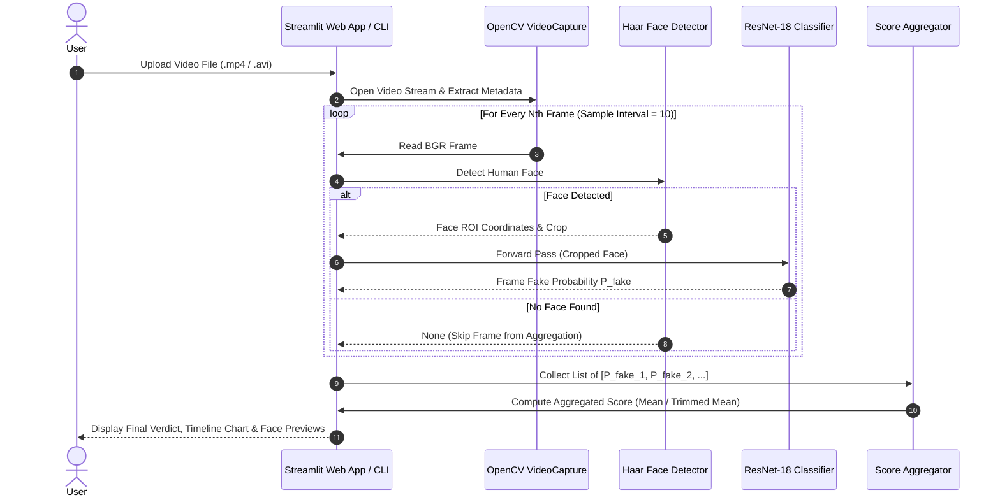
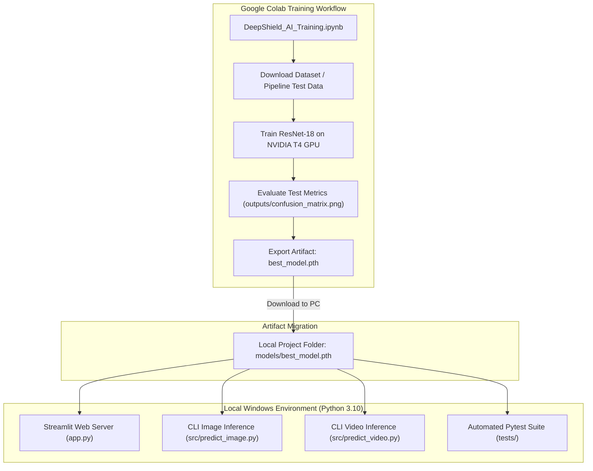

# DeepShield AI — System Architecture and Data-Flow Specifications

## 1. High-Level System Architecture

The following diagram illustrates the complete software architecture of DeepShield AI, from dataset acquisition to web application serving.

---

## 2. Image Inference Data-Flow Diagram (DFD)

---

## 3. Video Frame Sampling and Score Aggregation Pipeline

---

## 4. Google Colab to Local Windows Deployment Architecture

