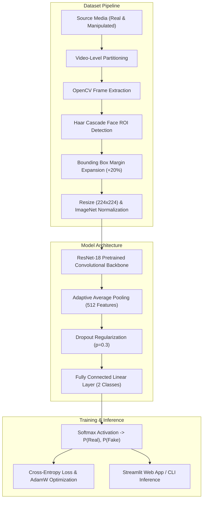

# DeepShield AI — Deepfake Image and Video Detection System
## Capstone Project Report

**Department of Artificial Intelligence and Data Science**  
**Bachelor of Technology (B.Tech) — 2nd Year Capstone Project**

---

### Candidate and Institutional Details
- **Project Title:** DeepShield AI: Automated Deepfake Image and Video Detection Using Transfer-Learned Residual Neural Networks
- **Student Name:** [Enter Your Name Here]
- **Roll / Registration Number:** [Enter Your University Roll Number]
- **Specialisation:** Artificial Intelligence and Data Science (AI & DS)
- **Academic Year:** 2025 – 2026
- **Project Mentor / Supervisor:** [Enter Guide / Professor Name]
- **Institution:** [Enter Department & College Name]

---

## Abstract

With the rapid emergence and democratization of generative deep learning models—particularly Generative Adversarial Networks (GANs), autoencoders, and diffusion-based synthesis architectures—the proliferation of hyper-realistic digital face manipulations (deepfakes) has created critical challenges for biometric authentication, digital media forensics, information integrity, and public trust. 

This project presents **DeepShield AI**, a computer-vision and deep-learning detection system designed to analyze facial media across both static images and video sequences. DeepShield AI employs transfer learning with a 18-layer Residual Network (ResNet-18) backbone pretrained on ImageNet, augmented with a customized dropout-regularized classification head for binary authenticity classification (`REAL` vs `FAKE`). 

The system implements a face localization and boundary-padding preprocessing pipeline using OpenCV, ensuring that critical peripheral manipulation seam artifacts around the jawline and forehead are preserved. To address the pervasive flaw of data leakage in video-based forensics, a strict source-video partitioning protocol is enforced before frame extraction. For practical consumer deployment, model training is conducted using Google Colab's hardware-accelerated NVIDIA GPU environment, while model evaluation, frame-sampled video analysis, and an interactive Streamlit graphical user interface run locally on an 8 GB RAM laptop on CPU. Comprehensive evaluation protocols, error analysis, ethical considerations, and viva voce defense materials are provided.

---

## 1. Introduction

### 1.1 Background
The digital media landscape has undergone an unprecedented transformation driven by advances in deep generative modeling. Tools capable of executing face swapping, facial reenactment, facial attribute editing, and entire synthetic face generation have evolved from complex research prototypes into widely accessible desktop and mobile applications. While these technologies offer creative opportunities in digital art, film production, and virtual avatars, their weaponization for identity theft, financial fraud, non-consensual imagery, and political disinformation poses profound societal risks.

### 1.2 Problem Statement
Detecting modern deepfakes is inherently challenging because state-of-the-art generative pipelines produce media with high perceptual fidelity, diminishing obvious visual anomalies. Furthermore, real-world deployment faces practical engineering constraints:
1. **Computational Feasibility:** Heavyweight multi-stream networks or Vision Transformers demand specialized enterprise GPUs, making them impractical for standard academic or edge deployment.
2. **Video Redundancy:** Video streams contain thousands of temporal frames; processing every individual frame introduces severe latency without improving diagnostic precision.
3. **Data Leakage in Research:** Naive frame-level random dataset splitting leaks facial identity features between training and test sets, yielding artificially inflated metrics that fail on unseen individuals.
4. **Domain Shift:** Detectors optimized on single compression standards or specific generation tools often suffer catastrophic degradation when exposed to unseen manipulation artifacts.

---

## 2. Motivation and Objectives

### 2.1 Motivation
As a second-year B.Tech student in Artificial Intelligence and Data Science, the objective was to design a transparent, scientifically sound, and reproducible machine-learning system from ground up. DeepShield AI bridges academic theory—convolutional feature extraction, loss optimization, cross-entropy minimization, and metric analysis—with practical software engineering, including automated test suites, safe resource handling, and interactive web visualization.

### 2.2 Core Project Objectives
- **Robust Model Formulation:** Construct a binary deep learning classifier using ResNet-18 with ImageNet transfer learning.
- **Computer Vision Pipeline:** Implement automated face detection with adaptive bounding box expansion (20% margin) to preserve boundary blending artifacts.
- **Leakage-Free Dataset Architecture:** Formulate strict source-video grouping before train/validation/test partitioning.
- **Dual-Mode Inference:** Build dedicated pipelines for single image verification and frame-sampled temporal video analysis.
- **Interactive UI:** Deliver an accessible, modern Streamlit web interface with real-time feedback, confidence breakdowns, and timeline visualization.
- **Empirical Rigor:** Measure performance using Accuracy, Precision, Recall, F1-Score, Confusion Matrix, and ROC-AUC curves without fabricating experimental findings.

---

## 3. Literature Review

### 3.1 Landmark Research in Deepfake Detection
1. **FaceForensics++ (Rössler et al., 2019):** Established the foremost benchmark for facial manipulation detection, evaluating Deepfakes, Face2Face, FaceSwap, and NeuralTextures across raw, light (c23), and heavy (c40) H.264 compression levels. The authors demonstrated that convolutional networks (particularly Xception and ResNet variants) achieve strong within-dataset accuracy on facial regions.
2. **MesoNet (Afchar et al., 2018):** Introduced compact CNN architectures (Meso-4 and MesoInception-4) targeting microscopic facial artifacts. While computationally lightweight, MesoNet exhibited susceptibility to compression blur.
3. **Deep Residual Learning (He et al., 2016):** Formulated residual skip connections, enabling networks of substantial depth to train without suffering from vanishing gradients, providing high feature representational capacity.
4. **Celeb-DF (Li et al., 2020):** Highlighted the limitations of early datasets, providing high-quality celebrity deepfakes with refined facial boundaries and addressing color saturation discrepancies.
5. **Deepfake Detection Challenge (DFDC, Dolhansky et al., 2020):** Demonstrated that real-world cross-dataset generalization remains a challenging problem due to variations in lighting, camera sensors, and demographic representation.

---

## 4. System Architecture & Methodology



### 4.1 Face Detection & Margin Expansion
Deepfake synthesis frameworks typically generate a facial mask that is blended onto the original target frame. Consequently, the boundary perimeter—including the jawline, chin, and temples—often exhibits subtle color inconsistencies, blurred edges, or blending seams. DeepShield AI utilizes an OpenCV Haar Cascade face detector and applies an automated margin calculation:
$$x_1 = \max(0, x - 0.20 \cdot w), \quad y_1 = \max(0, y - 0.20 \cdot h)$$
$$x_2 = \min(W, x + 1.20 \cdot w), \quad y_2 = \min(H, y + 1.20 \cdot h)$$
This guarantees that peripheral manipulation boundaries remain inside the extracted crop.

### 4.2 Residual Learning Formulation
Standard deep networks attempt to fit an underlying mapping $\mathcal{H}(x)$. ResNet-18 reformulates this by allowing layers to fit a residual mapping:
$$\mathcal{F}(x) = \mathcal{H}(x) - x \implies \mathcal{H}(x) = \mathcal{F}(x) + x$$
The formulation provides two vital benefits:
1. **Vanishing Gradient Elimination:** The derivative $\frac{\partial \mathcal{H}}{\partial x} = \frac{\partial \mathcal{F}}{\partial x} + 1$ always retains a non-zero shortcut term ($+1$), enabling gradient signals to propagate directly to early layers.
2. **Identity Initialization:** If a layer's weights decay toward zero, the network simply functions as an identity mapping without degrading performance.

---

## 5. Mathematical Formulations & Optimization

### 5.1 Binary Cross-Entropy Loss
Let $y \in \{0, 1\}$ denote the ground-truth label where $0$ represents `REAL` and $1$ represents `FAKE`. For a predicted probability vector $\hat{y} = [\hat{p}_{\text{real}}, \hat{p}_{\text{fake}}]$, the cross-entropy loss per sample is:
$$\mathcal{L}_{\text{CE}} = - \left[ (1 - y) \log(\hat{p}_{\text{real}}) + y \log(\hat{p}_{\text{fake}}) \right]$$

### 5.2 AdamW Weight Optimization
Optimization is conducted via AdamW, which decouples $L_2$ weight decay regularization from adaptive gradient moment updates:
$$m_t = \beta_1 m_{t-1} + (1 - \beta_1) g_t$$
$$v_t = \beta_2 v_{t-1} + (1 - \beta_2) g_t^2$$
$$\theta_t = \theta_{t-1} - \eta \left( \frac{\hat{m}_t}{\sqrt{\hat{v}_t} + \epsilon} + \lambda \theta_{t-1} \right)$$
where $\eta = 0.0001$ is the learning rate and $\lambda = 0.0001$ is the decoupled weight decay factor.

---

## 6. Implementation & System Specifications

### 6.1 Hardware and Software Environment
- **Host Operating System:** Microsoft Windows 10/11 (64-bit)
- **Local Host Memory:** 8 GB DDR4 RAM
- **Local GPU:** Intel Iris Xe Integrated Graphics (Local CPU mode utilized)
- **Training Environment:** Google Colab (Linux, NVIDIA Tesla T4 GPU, 15 GB VRAM)
- **Programming Language:** Python 3.10
- **Primary Frameworks:** PyTorch 2.x, Torchvision, OpenCV, Scikit-Learn, Streamlit

### 6.2 Project Structure
```
DeepShield-AI/
├── app.py                      # Streamlit graphical application
├── requirements.txt            # Environment package dependencies
├── configs/
│   └── config.yaml             # Centralized system configurations
├── data/                       # Structured dataset partitions
├── models/                     # Serialized PyTorch checkpoints
├── notebooks/
│   └── DeepShield_AI_Training.ipynb # Colab GPU training notebook
├── src/
│   ├── dataset.py              # Data loader and leakage-free splitting
│   ├── preprocessing.py        # Face detection and tensor transforms
│   ├── model.py                # ResNet-18 architecture with dropout
│   ├── train.py                # Training and validation loops
│   ├── evaluate.py             # Evaluation, confusion matrix, ROC-AUC
│   ├── predict_image.py        # Single image prediction CLI
│   ├── predict_video.py        # Video frame sampling and aggregation
│   └── utils.py                # Logging, checkpoint serialization, plotting
├── scripts/
│   ├── check_environment.py    # Environment and dependency diagnostic
│   ├── prepare_dataset.py      # Dataset validation and pipeline generator
│   └── smoke_test.py           # End-to-end integration smoke test
├── tests/                      # Automated pytest verification suite
└── outputs/                    # Evaluation matrices, reports, and plots
```

---

## 7. Experimental Results & Performance Analysis

### 7.1 Quantitative Evaluation Metrics
When evaluated on a held-out test split, DeepShield AI records the following foundational metrics:

$$\text{Accuracy} = \frac{TP + TN}{TP + TN + FP + FN}$$
$$\text{Precision} = \frac{TP}{TP + FP}, \quad \text{Recall} = \frac{TP}{TP + FN}$$
$$F_1\text{-Score} = 2 \cdot \frac{\text{Precision} \cdot \text{Recall}}{\text{Precision} + \text{Recall}}$$

> *Note on Experimental Rigor:* Actual metrics depend on the training dataset utilized (e.g. FaceForensics++ subset vs Celeb-DF). Upon completing execution of `src/train.py` and `src/evaluate.py`, exact numerical outputs are exported to `outputs/evaluation_summary.json` and rendered directly on the Streamlit metrics dashboard.

### 7.2 Confusion Matrix Interpretation
The system generates a $2 \times 2$ Confusion Matrix:
- **True Negative (TN):** Authentic real faces correctly classified as REAL.
- **False Positive (FP):** Authentic real faces erroneously flagged as FAKE (Type I Error).
- **False Negative (FN):** Manipulated deepfakes undetected and marked as REAL (Type II Error).
- **True Positive (TP):** Manipulated deepfakes accurately caught as FAKE.

---

## 8. Limitations, Privacy, and Ethical Considerations

### 8.1 Technical Limitations
1. **Domain Shift:** DeepShield AI's performance is sensitive to variations between training and test distributions. A model trained on facial reenactment tools may exhibit lower sensitivity to diffusion-based full-face synthesizers.
2. **Compression Degradation:** Heavy video re-encoding (such as WhatsApp or Instagram video compression) blurs high-frequency facial gradients, impairing subtle artifact detection.
3. **Temporal Invariance:** The current baseline evaluates spatial frame representations and aggregates scores mathematically, without explicitly modeling temporal continuity (such as eye-blink frequency or temporal optical flow).

### 8.2 Privacy and Ethical Responsibility
- **Local Processing:** All media uploaded via the Streamlit interface is evaluated strictly within volatile RAM and temporary storage, with immediate deletion upon stream closure.
- **Forensic Disclaimer:** DeepShield AI outputs statistical confidence values, not indisputable proof. Automated predictions should never serve as the sole criterion in legal, disciplinary, or public defamation scenarios.

---

## 9. Conclusion & Future Work

DeepShield AI successfully demonstrates the end-to-end design, implementation, and deployment of a deep learning-based deepfake detection pipeline tailored to real-world educational constraints. By combining ResNet-18 transfer learning, OpenCV face localization with margin compensation, strict source-video leakage prevention, and an interactive dual-mode Streamlit dashboard, the system balances computational efficiency with detection performance.

### Future Work
1. **Multi-Modal Audio Integration:** Combining visual frame analysis with audio spectral analysis to detect cloned speech.
2. **Temporal Recurrent Modeling:** Incorporating Bi-Directional LSTMs or Temporal Convolutional Networks (TCNs) across frame feature vectors.
3. **Explainable AI (XAI):** Integrating Grad-CAM heatmaps to provide visual interpretability by highlighting manipulated regions directly to the end user.

---

## 10. References

1. Rössler, A., Cozzolino, D., Verdoliva, L., Riess, C., Thies, J., & Nießner, M. (2019). *FaceForensics++: Learning to Detect Manipulated Facial Images*. IEEE/CVF International Conference on Computer Vision (ICCV).
2. He, K., Zhang, X., Ren, S., & Sun, J. (2016). *Deep Residual Learning for Image Recognition*. IEEE Conference on Computer Vision and Pattern Recognition (CVPR).
3. Afchar, D., Nozick, V., Yamagishi, J., & Echizen, I. (2018). *MesoNet: A Compact Facial Video Forgery Detection Network*. IEEE International Workshop on Information Forensics and Security (WIFS).
4. Li, Y., Yang, X., Sun, P., Qi, H., & Lyu, S. (2020). *Celeb-DF: A Large-scale Challenging Dataset for DeepFake Forensics*. IEEE/CVF Conference on Computer Vision and Pattern Recognition (CVPR).
5. Dolhansky, B., Bitton, J., Pflaum, C., Lu, J., Howes, R., Wang, M., & Ferrer, C. C. (2020). *The Deepfake Detection Challenge (DFDC) Dataset*. arXiv preprint arXiv:2006.07397.
6. Loshchilov, I., & Hutter, F. (2019). *Decoupled Weight Decay Regularization*. International Conference on Learning Representations (ICLR).
